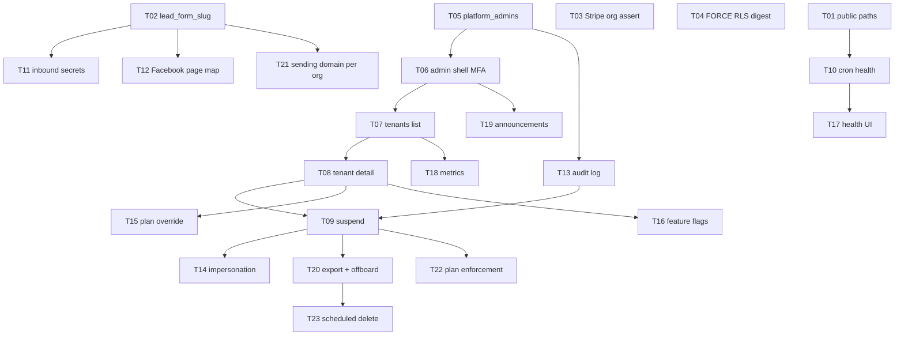

# Multi-tenancy and platform admin plan

Date: 2026-10-12
Status: planning only (no code in this PR)
Audience: Dusty (owner) and the next agent that implements tickets
Inputs: `supabase/migrations` (122 files), `supabase/tests` (pgTAP), `apps/web` (auth, public routes, webhooks, cron, service-role clients), `docs/superpowers/specs/2026-10-08-lawnquoter-platform-design.md`

> For later implementation: treat each ticket in §5 as its own tracer bullet. Do not start Phase 1 until Phase 0 isolation tickets that block a second live customer are done or explicitly waived.

---

## 1. Verdict

**Yes — LawnQuoter is already a shared-database multi-tenant app.** Each lawn-care company is an `orgs` row. Office staff and crews belong through `memberships`. Almost every business table carries `org_id`, has RLS enabled and forced, and refuses rows that are not in the caller’s active company. A signed-in user can belong to more than one company and switch in the header. Public customer pages (quotes, invoices, portal) load one tenant by a secret token, not by scanning every company.

**It is not yet ready to sell as a multi-customer SaaS with Dusty as the operator.** There is no platform admin panel, no way to suspend a tenant, no plan enforcement, no tenant delete, and several public/integration paths still behave like a single hosted product (one Facebook page, one Resend account, one `EMAIL_FROM`, shared inbound webhook secrets). The original design said this out loud: “single-tenant for the owner company first, multi-tenant-ready from day one” and put “SaaS: onboarding, subscription billing, org switching, metering” last (`docs/superpowers/specs/2026-10-08-lawnquoter-platform-design.md` §3 and §6 step 16). The data model landed. The operator product did not.

### How tenant isolation is enforced

```text
signup
  → profiles row (no company yet)
  → /onboarding calls public.create_org
      inserts orgs + owner membership + profiles.active_org_id
  → auth.refreshSession
      public.custom_access_token_hook stamps app_metadata.org_id + org_role
  → private.current_org_id() reads the JWT
  → private.is_org_member(row.org_id) requires
        JWT org == row org
        AND an active memberships row for auth.uid()
```

| Layer | What it does | Strength |
|---|---|---|
| **Postgres RLS + FORCE RLS** | Tenant tables in `public` are enabled and forced. A table owner cannot quietly skip RLS. Helpers wrap `auth.jwt()` / `auth.uid()` in `(select …)` for plan caching. | **Strong** for office and crew queries that go through the user-scoped client. |
| **Memberships, not JWT role** | `private.has_org_role` / `is_org_member` re-check `memberships.status = 'active'` and the role in the table. A spoofed `app_metadata.org_role` does not elevate. A disabled member is locked out even with a still-fresh token. Proven in `supabase/tests/010_foundation_rls.sql` and `090_privilege_gaps.sql`. | **Strong.** |
| **Same-org triggers** | Child rows cannot point at a parent in another company (`private.child_org_guard`, `assert_same_org`, `portal_same_org`, bid/property checks). | **Strong** against cross-tenant foreign keys. |
| **JWT active org** | One org per access token. Switching calls `set_active_org` then `refreshSession`. Until refresh, RLS still uses the old org. | **Correct by design**; easy to misuse if a client caches the old org. |
| **Public tokens** | `/q`, `/i`, `/co`, `/s`, `/portal` resolve by UUID `public_token` / portal `token` through `SECURITY DEFINER` RPCs or a server admin client scoped to that token. Anon cannot `SELECT` tenant tables. | **Strong** if tokens stay secret (UUID entropy). |
| **Public slugs** | `/r/[slug]` and `/w/[slug]` look up `orgs.settings->>'lead_form_slug'` with the service-role client. | **Weaker**: slug secrecy + no unique index + the app never writes the slug. |
| **Service role** | `createAdminClient()` bypasses RLS. Comment in `apps/web/src/lib/supabase/server.ts` says “always scope queries by org_id.” Most paths do. A few do not assert the org they think they have. | **As strong as the caller.** |
| **Storage** | Paths are `{org_id}/…`. Policies parse the folder and call `is_org_member`. `org-branding` is a public bucket (URL is the ACL). | **Good** for private buckets; **URL-secrecy** for logos. |

**Bottom line for Dusty:** two lawn-care companies in the same database cannot see each other’s accounts, quotes, or invoices through the office app. That part is real. What is missing is the product around it: each company’s public URLs, email identity, inbound leads, paid plan, and a panel where you can find, help, suspend, or remove them.

---

## 2. Gap list

Severity: **P0** = can leak data, take money, or break every tenant’s payments/cron before a second customer is live. **P1** = a second customer will hit this in week one. **P2** = needed to operate the SaaS. **P3** = scale / polish.

### P0 — fix before a second live customer

| ID | Gap | Why it matters | Cite |
|---|---|---|---|
| G1 | Session proxy sends anonymous machine traffic to `/login`. Stripe, SignWell, Vercel cron, QuickBooks OAuth return, and invoice checkout are **not** on the public-path list. Vercel Cron and Stripe have no cookies, so they get an HTML login redirect instead of the handler. | Payments, e-sign completion, abandoned-quote texts, payment reminders, and QBO connect can fail for **every** tenant at once. | `apps/web/src/lib/supabase/proxy.ts` (`PUBLIC_PREFIXES`), `apps/web/src/proxy.ts` (matcher hits all API routes), `apps/web/src/lib/supabase/proxy.test.ts` (Twilio/CallRail covered; Stripe/SignWell/cron/QBO/`/api/i/` omitted), `apps/web/vercel.json`, `apps/web/src/app/api/webhooks/stripe/route.ts`, `apps/web/src/app/api/webhooks/signwell/route.ts`, `apps/web/src/app/api/qbo/callback/route.ts`, `apps/web/src/app/api/i/[token]/checkout/route.ts` |
| G2 | Hosted form and instant-quote widget resolve **only** `settings.lead_form_slug`. Nothing in the app writes that key. Settings copy uses `orgs.slug` as a fallback, so the printed `/r/{slug}` and `/w/{slug}` links **404** after a normal onboarding. There is also **no unique index** on `lead_form_slug`; two companies could collide if it is ever set by hand. | The public “each company has its own quote page” path is not actually live. | `apps/web/src/lib/leads/load-public-form.ts`, `apps/web/src/lib/leads/intake-store.ts`, `apps/web/src/lib/leads/embed-snippets.ts` (`leadFormSlugFromOrg`), `apps/web/src/app/(app)/settings/page.tsx`, `supabase/migrations/20261010204800_lead_intake_schema.sql` (comment: “set when form enabled”), `supabase/migrations/20261008000100_foundation.sql` (`create_org`), `supabase/migrations/20261017001000_org_onboarding_step.sql` |
| G3 | Facebook Lead Ads always insert into **one** company: `INBOUND_LEAD_ORG_SLUG`. One Page token, one verify token, one secret. | A second customer’s Facebook form cannot land in their tenant without stealing the first company’s leads, or vice versa. | `apps/web/src/app/api/public/leads/facebook/route.ts` |
| G4 | Inbound connectors (Google LSA, Thumbtack, Yelp, Angi, Zapier) share **one platform bearer secret per integration**. Tenant is chosen by `slug` in the JSON body. Anyone who has the secret can write a lead to any company whose slug they know. | Wrong-tenant lead injection. Slug is also the unset `lead_form_slug` (G2). | `apps/web/src/lib/leads/inbound.ts`, `apps/web/src/app/api/public/leads/inbound/[connector]/route.ts` |
| G5 | Stripe payment webhook loads the invoice by id and writes `payments.org_id` from metadata **or** the invoice, without asserting they match. `findInvoiceById` does not take an org. A signed event with swapped metadata could attribute a payment to the wrong company (forgery still needs `STRIPE_WEBHOOK_SECRET`). | Ledger / payout confusion across tenants. | `apps/web/src/lib/billing/stripe-payment-webhook.ts` (`orgId ?? invoice.orgId`), `apps/web/src/lib/billing/supabase-stripe-payment-store.ts` (`findInvoiceById`) |

### P1 — second customer will feel these

| ID | Gap | Why it matters | Cite |
|---|---|---|---|
| G6 | Outbound email uses one global `EMAIL_FROM` and one `RESEND_API_KEY`. `/settings/sending` lists **every** domain on the Resend account, not the caller’s org. No `orgs.sending_domain` column. Abandoned-quote cron and payment reminders all send as LawnQuoter. | Customers see the platform mailbox. One tenant can add a domain that another tenant then sees. | `apps/web/src/lib/email/provider.ts`, `apps/web/src/lib/email/sending-domain.ts`, `apps/web/src/app/(app)/settings/sending/page.tsx`, `apps/web/src/app/api/cron/abandoned-quotes/route.ts` |
| G7 | No org status. No suspend / reactivate. `orgs` has no `status` column. A disabled **member** is locked out; a bad **company** cannot be frozen. Cron, widgets, and Connect payouts would keep running. | You cannot shut off a non-paying or abusive tenant without deleting rows. | `supabase/migrations/20261008000100_foundation.sql`; no later `orgs.status` |
| G8 | `org_subscriptions` exists (`starter` / `growth` / `scale`) but **nothing in the product reads the tier to allow or deny a feature**. Checkout is gated to Stripe **test** keys (`orgBillingGate`). `usage_meters` / `record_usage` count imagery and measurements only. | Plans are a settings card, not a product. A canceled org keeps the full app. | `supabase/migrations/20261017006500_org_subscriptions.sql`, `supabase/migrations/20261017003000_usage_meters.sql`, `apps/web/src/lib/billing/org-plan.ts`, `apps/web/src/app/(app)/settings/org-plan-actions.ts`, `apps/web/src/app/(app)/properties/[id]/measure/page.tsx` |
| G9 | Instant-quote abandon `POST /api/public/instant-quote/abandon` has no Turnstile, no IP cap, and stores addresses. Intake itself is capped (5/IP/hour, 60/org/hour). `create_org` has no rate limit: any signed-in user can mint unlimited companies. | Spam tables and noisy-neighbor orgs. | `apps/web/src/app/api/public/instant-quote/abandon/route.ts`, `apps/web/src/lib/leads/submit-request.ts`, `supabase/migrations/20261017001000_org_onboarding_step.sql` |
| G10 | Cron jobs `quote-quiet` and `abandoned-quotes` load **all** matching quotes in the database, then loop with the service role. Lead-follow-up digest and payment reminders iterate orgs. No shard, no per-org budget. | One busy company slows texts and flags for everyone. Cost scales with total quotes, not active automations. | `apps/web/src/app/api/cron/quote-quiet/route.ts`, `apps/web/src/app/api/cron/abandoned-quotes/route.ts`, `apps/web/src/app/api/cron/lead-follow-up-digest/route.ts`, `apps/web/src/app/api/cron/payment-reminders/route.ts`, `apps/web/src/app/api/cron/quote-follow-ups/route.ts` |
| G11 | Export is four tables (accounts, properties, quotes, invoices), 20k rows each, no contacts, visits, payments, measurements, or photos. There is **no delete-company RPC or UI**. Design promised `export_jobs` and “one-click full data export”; neither exists as a job. Lead purge (`purge_expired_leads`) is retention, not tenant erasure. | You cannot honor “give me my data” or “delete us” completely. Deleting an `orgs` row by service role **would** cascade (destructive, no undo, no admin UI). | `apps/web/src/app/(app)/settings/export/route.ts`, `supabase/migrations/20261010214700_lead_retention_purge.sql`, `docs/superpowers/specs/2026-10-08-lawnquoter-platform-design.md` §5.14 |
| G12 | Accepting an invite only sets `profiles.active_org_id` when it is **null**. A user already in company A who accepts company B’s invite stays on A until they notice the switcher. | “I joined but I still see the other shop.” | `supabase/migrations/20261009130000_privilege_gaps.sql` (`accept_org_invite`), `apps/web/src/app/invites/accept/actions.ts` |
| G13 | `lead_follow_up_digest_runs` has RLS but **not FORCE RLS**. Diverges from the foundation rule. | Table owner / unusual roles could bypass. Low practical risk today; cheap to close. | `supabase/migrations/20261010208000_lead_follow_up_digest.sql` |

### P2 — operator and SaaS product

| ID | Gap | Why it matters | Cite |
|---|---|---|---|
| G14 | **No platform admin.** Roles are org-scoped only (`owner`, `admin`, `sales`, …). Nothing like `platform_admins`. No `/admin` route group. No tenant search, health, impersonation, comps, or announcements. | Dusty cannot see or help customers without a direct database login (service role). | `packages/shared/src/roles.ts`, `apps/web/src/lib/auth/session.ts`, `apps/web/src/app/(app)/` |
| G15 | No custom domain or subdomain routing. One `NEXT_PUBLIC_APP_URL`. No middleware host map. | `acme.lawnquoter.com` or `quotes.acmelawn.com` is not a thing. Path slugs only — and those 404 today (G2). | `apps/web/src/proxy.ts`, `apps/web/src/lib/leads/embed-snippets.ts` |
| G16 | Twilio and call-tracking numbers **are** unique per org (good). A2P 10DLC is per-org (`org_sms_registrations`) but carrier fees are **money** and review is weeks. Stripe Connect is one Express account per org (good). SignWell is one platform API key; tenant is the document id. QBO `realm_id` is **not** unique — two orgs could attach the same QuickBooks company. | Phone and card money are isolated. Email/SMS brand registration and QBO uniqueness are not finished. | `supabase/migrations/20261017006700_sms_number_unique.sql`, `20261017007100_phone_claim_unique.sql`, `20261017006800_sms_registration.sql`, `20261010204000_stripe_connect.sql`, `20261017004600_qbo_sync.sql`, `apps/web/src/app/api/webhooks/signwell/route.ts` |
| G17 | `audit_events` is the **quote ESIGN trail**, not an operator audit log. No table for “Dusty suspended org X” or “support opened tenant Y”. | You cannot prove who did operator actions. | `supabase/migrations/20261008000600_acceptances.sql` |
| G18 | No feature-flag table or per-tenant flags. No in-app announcements. | Every feature ships to every org. No “Scale-only routing” or “we are down Tuesday” banner. | App-wide search; only schedule “flags” (visit attention), not product flags |
| G19 | CallRail “signature” is a shared-secret string compare (`CALLRAIL_WEBHOOK_SECRET`), not body HMAC. One secret for the platform. Tenant is still the tracking number. | Forged call rows if the secret leaks. | `apps/web/src/lib/messaging/calls.ts`, `apps/web/src/app/api/webhooks/callrail/route.ts` |
| G20 | No ownership transfer. `updateMember` rejects `owner`. Last owner leaving has no path. | Stuck tenant if Dusty’s customer sells the shop. | `apps/web/src/app/(app)/settings/actions.ts` |
| G21 | No “create another company” after the first org. `create_org` still works if you call the RPC. Onboarding hides the company step once JWT has an org. | A landscaper who also runs a snow company must use an invite or a raw RPC. | `apps/web/src/app/onboarding/page.tsx`, `apps/web/src/app/onboarding/onboarding-form.tsx` |
| G22 | pgTAP cross-org deny is excellent on foundation, CRM, quotes, jobs, crew, QBO, subscriptions. Weaker or missing on `change_orders`, `lead_follow_up_digest_runs`, `invoice_payment_reminder_runs`, `automation_runs`, `crew_phone_sync`, `visit_time_corrections`. ~254 `SECURITY DEFINER` functions; allowlist in `095_definer_execute.sql` but not a per-function org-id audit. | New tables can ship without a “other org cannot read this” test. | `supabase/tests/` |

### P3 — by design or low risk (still list them)

| ID | Gap | Notes | Cite |
|---|---|---|---|
| G23 | `profiles` and `crew_pins` have no `org_id`. Profiles are per user; pins are per `user_id` via RPCs. `private.site_check_request_rate` has no RLS; grants are service-only. | Acceptable if grants stay tight. | `20261008000100_foundation.sql`, `20261010215100_crew_pin_lock.sql`, `20261010202500_site_check_request.sql` |
| G24 | `org-branding` is a public bucket. Path is `{org_uuid}/…`. Anyone with the URL can fetch the logo. | UUID entropy; do not put private docs here. | `20261009120000_org_branding.sql`, `apps/web/src/lib/brand/urls.ts` |
| G25 | `site-walk-photos` SELECT is any org member, not bid-scoped. | Intra-tenant over-share, not cross-tenant. | `20261017005100_site_walk_photos.sql` |
| G26 | `supabase_auth_admin` can `SELECT` all memberships/profiles (`using (true)`). Required for the access-token hook. | Compromise of that role is cluster-wide. Do not grant it elsewhere. | `20261009011855_fix_access_token_hook.sql` |
| G27 | No Supabase Edge Functions in repo. Heavy work is Vercel Node routes. pg_cron is used for visit-horizon extend and lead purge when the extension exists. | Fine. Do not put PDF or cron fan-out in Edge Functions. | `20261010190500_rolling_visit_horizon.sql`, `20261010214700_lead_retention_purge.sql` |
| G28 | Roles are **not** stored in `user_metadata`. Hook writes `app_metadata`. App reads `app_metadata` only. | Keep it that way for platform admin too. | `20261008000100_foundation.sql`, `apps/web/src/lib/auth/session.ts`, `packages/shared/src/roles.ts` |

### What is already in good shape

- **Org + membership + forced RLS** on ~93 tenant tables; JWT spoof and disabled-member tests pass (`010_foundation_rls.sql`, `090_privilege_gaps.sql`).
- **Org switcher** in the office header (`apps/web/src/components/app-shell/office-shell.tsx` + `activate-org.ts`).
- **Invites** with hashed tokens, 7-day expiry, admin revoke (`20261009130000_privilege_gaps.sql`).
- **Branding** on the org row + `org-branding` bucket; public quotes pull live branding (`quote_public`).
- **Stripe Connect** one Express account per org; unique `stripe_account_id`.
- **Twilio / call-tracking** unique claims; inbound SMS resolves `orgs.sms_number`.
- **QBO OAuth state** HMAC-binds `orgId` (`apps/web/src/lib/billing/qbo-oauth.ts`). Tokens table is deny-all RLS (`20261017006400_qbo_oauth_tokens.sql`).
- **Customer portal** magic-link UUID, server-side token check, same-org triggers (`20261017006000_customer_portal.sql`, `apps/web/src/lib/portal/load.ts`).
- **Service-role client** is `server-only`; secret key is never imported in client components (`apps/web/src/lib/supabase/server.ts`).
- **SaaS plan table + webhook upsert** exist; writes are service-role only (`221_org_subscriptions.sql`).

---

## 3. Tenant experience

### Signup → own workspace

Works today:

1. Email/password or magic link (`apps/web/src/app/(auth)/login/login-form.tsx`). Trigger creates `profiles` only.
2. `requireOrg()` sends a user with no JWT org to `/onboarding`.
3. Wizard: company → branding → services → team → area (`apps/web/src/app/onboarding/wizard.ts`).
4. `create_org(name, slug, timezone)` makes the company, owner membership, and `active_org_id`. Slug is globally unique (`orgs.slug`).
5. Client refreshes the session so the hook stamps the new org.
6. New orgs start at `settings.onboarding_step = 'branding'`. Legacy orgs with empty settings are treated as finished.

Gaps: public `/r` and `/w` URLs do not work (G2). There is no second-company button (G21). `create_org` is unbounded (G9).

### One person, several companies

Works today:

- Many `memberships` rows per user.
- Header menu lists active memberships (`apps/web/src/app/(app)/layout.tsx`).
- Switch calls `set_active_org` + `refreshSession` + `router.replace("/dashboard")`.

Gaps: switch always dumps to `/dashboard` (loses the page you were on). Invite accept does not switch if you already have an active org (G12). No “create another company” in the menu.

### Per-tenant URLs

| Kind | Today | Needed |
|---|---|---|
| **Path slug (office handle)** | `orgs.slug`, unique, set at create. Used in settings copy. | Keep as the human handle. |
| **Public form / widget** | Intended: `/r/{lead_form_slug}`, `/w/{lead_form_slug}`. Actual lookup ignores `orgs.slug`. | Write a unique, unguessable `lead_form_slug` at org create; unique index; settings can rotate it. |
| **Customer artifacts** | `/q/{token}`, `/i/{token}`, `/co/{token}`, `/s/{token}`, `/portal/{token}`. | Keep UUIDs. Do not put these on guessable slugs. |
| **Subdomain** | None. | Only if Dusty wants `acme.lawnquoter.com`. Needs host routing in `proxy.ts` and a reserved-name list. **Money** if we use Vercel wildcard domains. |
| **Custom domain** | None. | `quotes.acmelawn.com` → that org’s `/r` and `/w`. **Money** (SSL, DNS, Vercel domain API). Do not start this in Phase 0. |
| **Sending domain** | Shared Resend + `EMAIL_FROM`. | Store verified domain per org; send as `{name} <quotes@mail.acmelawn.com>` with a LawnQuoter fallback. **Money** (Resend domains, extra DNS). |

### Offboarding and deletion

| Step | Today |
|---|---|
| Cancel Stripe plan | Webhook can mark `org_subscriptions.status = canceled`. App does not lock. |
| Export | Partial ZIP, owner/admin, four tables. |
| Suspend | Missing. |
| Delete company | No RPC, no UI, no grace period. FK `on delete cascade` from `orgs` would wipe tenant rows if someone deletes the org as service role. **Destructive.** |
| Delete user | `profiles` cascade from `auth.users`. Memberships go with the profile. Other orgs they belong to stay. |
| GDPR / “erase me” | Missing. |

Recommended lifecycle (product, not code): **active → past_due → suspended → canceled → export window → scheduled delete**. Suspend must stop cron, widgets, Connect charges, and office login for that org only.

---

## 4. Platform admin panel (Dusty’s console)

This is a **new product surface**, not an org role. An org `owner` must never become a platform admin by flipping a dropdown on `/settings/team`.

### 4.1 Role model

**Do this:**

```sql
-- new migration, timestamp left as first-committed on the branch
create table public.platform_admins (
  user_id uuid primary key references public.profiles(id) on delete cascade,
  role text not null check (role in ('owner', 'support', 'billing', 'readonly')),
  created_at timestamptz not null default now(),
  created_by uuid references public.profiles(id)
);

alter table public.platform_admins enable row level security;
alter table public.platform_admins force row level security;
-- no authenticated policies; service_role + SECURITY DEFINER readers only
```

| Rule | Why |
|---|---|
| **Never `user_metadata` or `app_metadata.platform_admin` as source of truth.** JWT can be a cache after a hook, but every admin query re-reads `platform_admins`. Same lesson as org roles (`090_privilege_gaps.sql`). | Stolen/stale JWT must not keep admin after you revoke the row. |
| **Separate from `org_role`.** Dusty can be platform `owner` and also a member of a demo org. Support can be platform `support` with **no** membership in customer orgs. | Impersonation and tenant list must work without joining the tenant. |
| **Seed Dusty by user id in a one-row SQL grant**, not an env email string in the client. Rotation = delete/insert the row. | Email change must not drop admin by accident; env email in the browser is forgeable. |
| **Roles:** `owner` (everything), `support` (read tenants, impersonate with consent, no comps), `billing` (plans/comps, no impersonate), `readonly` (metrics). | Least privilege. |

Server helper (sketch): `requirePlatformAdmin()` in `apps/web/src/lib/auth/platform.ts` uses the **user-scoped** client to call `public.platform_admin_role()` (`SECURITY DEFINER`, `search_path = ''`, reads `auth.uid()` against `platform_admins`). **Do not** use `createAdminClient()` in a Server Component just to ask “am I admin?”.

### 4.2 Route and security

```text
apps/web/src/app/(platform)/
  admin/
    layout.tsx          # requirePlatformAdmin + MFA + no office chrome
    page.tsx            # home: counts
    tenants/page.tsx
    tenants/[orgId]/page.tsx
    health/page.tsx
    metrics/page.tsx
    announcements/page.tsx
    audit/page.tsx
```

| Control | How |
|---|---|
| **Separate route group** | `(platform)` must not wrap `(app)` or reuse `OfficeShell`. Different nav, different cookies-ok, no tenant switcher. |
| **Server-only checks** | `layout.tsx` calls `requirePlatformAdmin()`. Every server action calls it again. No “hide the button” as the only gate. |
| **MFA** | Require Authenticator AAL2 (`supabase.auth.mfa`) before the layout renders. If AAL1, redirect to `/admin/mfa`. Org owners do not need this on day one; **platform admins do**. |
| **No service role on the client** | Same as today: `createAdminClient` stays in `server-only` modules. Admin UI uses RPCs that check `platform_admins` inside the function. |
| **Not on `PUBLIC_PREFIXES`** | `/admin` stays login-gated. After login, layout checks platform table + MFA. |
| **IP allowlist (optional)** | Env `PLATFORM_ADMIN_IP_ALLOWLIST` later. Do not block Dusty’s phone on v1. |
| **Rate limit** | Impersonation start, suspend, delete, and plan override: 10/hour/admin. |

### 4.3 Audit log

New table `platform_audit_events`:

| Column | Purpose |
|---|---|
| `id`, `at` | Identity + time |
| `actor_user_id` | Who (platform admin) |
| `action` | `tenant.view`, `tenant.suspend`, `tenant.reactivate`, `tenant.impersonate_start`, `tenant.impersonate_end`, `plan.override`, `flag.set`, `announcement.publish`, `tenant.export`, `tenant.delete_scheduled` |
| `org_id` | Target tenant (nullable for global actions) |
| `payload jsonb` | Before/after (no secrets, no raw tokens) |
| `request_id`, `ip`, `user_agent` | Forensics |

Write only from `SECURITY DEFINER` RPCs that already passed the platform-admin check. RLS: no `authenticated` policies. Admins read through `platform_audit_list()`.

**This is not `audit_events`.** That table is the customer ESIGN chain. Do not mix them.

### 4.4 Screens

**Tenants list (`/admin/tenants`)**

- Search: name, slug, owner email, Stripe customer id, SMS number.
- Columns: name, slug, plan + status, member count, created, last activity (max of quote sent / invoice issued / login if we store it), suspend flag.
- Filters: plan, subscription status, suspended, “no Connect”, “SMS pending”.
- Pagination. Service-role/RPC with `ilike` + limits; do not `select *` all orgs into the browser.

**Tenant detail (`/admin/tenants/[orgId]`)**

- Identity: name, slug, timezone, `lead_form_slug`, created.
- Plan: tier, Stripe ids, period end, **override / comp** (billing role).
- Usage: imagery sessions, measurements, quote count, invoice count (from existing tables + `usage_totals` pattern).
- Members: email, role, status. **Do not show** crew PINs or QBO tokens.
- Integrations: Connect status, QBO connected (realm id only), SMS number + 10DLC status, sending domain.
- Status: active / suspended + reason.
- Actions: suspend, reactivate, start impersonation (consent), request export, schedule delete (Phase 4).

**Suspend / reactivate**

- `orgs.status` = `active | suspended` (new column, default `active`).
- On suspend: `is_org_member` still true for data, but `requireOrg()` and public slug loaders refuse; cron skips `status <> 'active'`; Connect charges and widget reveal return a closed message.
- Reactivate clears the flag and writes audit.
- **Not destructive.** Do this before any delete.

**Impersonation / support access**

- Support does **not** join `memberships` as owner. That would show up on the customer’s Team page and confuse billing.
- Flow: support clicks “Request access” → tenant owner sees a banner / email → owner clicks Allow (24h) → `platform_support_grants (org_id, admin_user_id, expires_at, granted_by)` → support opens a **read-only** office view with a red “Viewing {org} as support” bar.
- Write path: only if the grant says `write_ok` (default false). Every write goes through the user client with a temporary JWT claim `support_org_id` **and** the grant row. Prefer read-only in v1.
- End: expiry, owner revoke, or support “end session”. Audit start/end.
- **Never** reuse the customer’s password. **Never** stamp platform admin into `user_metadata`.

**Plan overrides and comps**

- `org_subscriptions` grows `override_tier`, `override_until`, `comp_reason`, `overridden_by`.
- Webhook must **not** clobber an active override.
- Billing role only. Audit every change. Mark tickets that touch Stripe live keys as **money**.

**Feature flags per tenant**

- `org_feature_flags (org_id, flag, enabled, updated_at, updated_by)`.
- Start with a small allowlist in code: `paid_routing`, `instant_quote`, `sms`, `qbo`, `wisetack`.
- Server reads flags after `requireOrg()`. Default = on for active paid orgs, off for suspended.
- Do not build a generic flag service in v1.

**System health**

- Cards, not a new APM: last success time per cron path (write a `cron_runs` row at the end of each `/api/cron/*`), last Stripe/Twilio/SignWell webhook error, QBO conflict count, SMS 10DLC failed, email provider rejected.
- Source: existing tables (`qbo_conflicts`, `org_sms_registrations.last_error`, `stripe_events`) plus a thin `cron_runs` / `webhook_receipts` table.
- This is how Dusty sees G1 (cron never hitting) without opening Vercel.

**Metrics**

- MRR: sum of active `org_subscriptions` mapped through Stripe price env (test until live).
- Active tenants: `orgs` where `status = active` and (subscription active or comp).
- Quotes sent / accepted this week: `quotes` grouped by `org_id` then summed.
- v1 = SQL RPCs on existing tables. Do not add a warehouse.

**Announcements**

- `platform_announcements (id, title, body, level, starts_at, ends_at, org_id nullable)`.
- Office shell reads the current row for `current_org_id` or global (`org_id is null`).
- Publish action is platform-only + audit.

### 4.5 What not to do

- Do not put `platform_admin: true` in Supabase Dashboard user metadata and read it in React.
- Do not reuse `(app)/settings` with a hidden tab.
- Do not give support the service-role key in the browser.
- Do not impersonate by inserting an `owner` membership and forgetting to delete it.

---

## 5. Phased build plan (tracer-bullet tickets)

Sizes: **S** = one PR, one area, tests in the same suite that already exists. **M** = a few files + a migration. **L** = new surface (admin app or lifecycle). Blocking edges are ticket ids. **$** = vendor spend. **☠** = destructive / hard to undo.



### Phase 0 — Isolation hardening (second customer must not leak)

Ship these before inviting a company that is not Dusty’s.

| ID | Ticket | Size | Blocks | Notes |
|---|---|---|---|---|
| **T01** | Add Stripe, SignWell, `/api/cron`, `/api/qbo/callback`, `/api/i/` to `PUBLIC_PREFIXES` and extend `proxy.test.ts`. | S | — | **P0.** No migration. Confirm with a curl without cookies: webhook/cron return JSON 401/200, not `/login`. |
| **T02** | On `create_org`, set a unique `settings.lead_form_slug` (random, not the public handle). Unique index on `settings->>'lead_form_slug'`. Settings embed uses that value only. Fallback to `orgs.slug` in the **loader** as well, or stop printing `orgs.slug` as a public URL. | M | — | **P0.** pgTAP: two orgs cannot share a form slug; `/r/{slug}` resolves. |
| **T03** | Stripe payment webhook: if metadata `org_id` is present and ≠ `invoice.org_id`, ignore and alert. Always write `payments.org_id = invoice.org_id`. | S | — | **P0.** Extend `apps/web/src/lib/billing/stripe-payment-webhook.ts` tests. |
| **T04** | `ALTER TABLE lead_follow_up_digest_runs FORCE ROW LEVEL SECURITY` + cross-org pgTAP. | S | — | **P0.** Leave the hosted timestamp as first-committed. |
| **T05** | Cross-org pgTAP for `change_orders`, reminder runs, `automation_runs`. | S | — | Closes G22 for the tables we already have. |

### Phase 1 — Tenant experience (a second company can live on the product)

| ID | Ticket | Size | Blocks | Notes |
|---|---|---|---|---|
| **T06** | Settings: show and rotate `lead_form_slug`; copy `/r` and `/w` from the real key. | S | T02 | UI only after the column/index exists. |
| **T07** | Accept invite always `set_active_org` to the invited org, then refresh. | S | — | Fixes G12. |
| **T08** | “New company” in the org menu → same `create_org` + onboarding from branding. | S | T02 | Rate-limit `create_org` (e.g. 3/day/user) in the same PR. |
| **T09** | Per-org sending: `orgs.sending_from` + Resend domain id stored on the org. Sending page lists **that org’s** domain only. Fallback `EMAIL_FROM`. | M | — | **$** Resend domains. Do not list the whole account. |
| **T10** | Per-org inbound secrets: `org_inbound_secrets (org_id, connector, token_hash)`. Webhook auth = bearer matches **that org**, slug optional. | M | T02 | Replaces platform-wide secrets for Zapier/LSA/etc. |
| **T11** | Facebook: map `page_id` → `org_id`. One platform app, many pages. | M | T02 | **$** Meta app review if not already live. Until then, keep the env slug as a **dev-only** fallback. |
| **T12** | Turnstile + IP limit on instant-quote abandon. | S | — | Same helpers as intake. |
| **T13** | Cron: filter `orgs.status = 'active'` once T16 exists; until then, `WHERE` org has not canceled if easy. Narrow `quote-quiet` / `abandoned-quotes` to rows that still need work (`gone_quiet_at is null`, time window). | M | T01 | Stops full-table scans. |

### Phase 2 — Platform admin foundation

| ID | Ticket | Size | Blocks | Notes |
|---|---|---|---|---|
| **T14** | `platform_admins` + `platform_admin_role()` + `requirePlatformAdmin()`. Seed Dusty’s user id. pgTAP: org owner is not platform admin. | M | — | Never `user_metadata`. |
| **T15** | `platform_audit_events` + writer RPC. | M | T14 | Every later admin write uses this. |
| **T16** | `orgs.status` + `is_org_member` / public loaders / cron skip `suspended`. Office shows “This company is paused.” | M | T14, T15 | Not destructive. |
| **T17** | `(platform)/admin` layout: MFA gate, no office chrome, no service-role client. | M | T14 | **$** if SMS MFA; prefer TOTP (free). |
| **T18** | Tenants list + search. | M | T17 | Read via definer RPC, not `createAdminClient` in the page. |
| **T19** | Tenant detail (plan, usage, members, integrations). | M | T18 | No token secrets on the page. |
| **T20** | Suspend / reactivate buttons + audit. | S | T16, T19, T15 | |
| **T21** | `cron_runs` written by each cron; `/admin/health`. | S | T01, T17 | Makes G1 visible. |

### Phase 3 — Operator tools

| ID | Ticket | Size | Blocks | Notes |
|---|---|---|---|---|
| **T22** | Support grants + read-only impersonation + red banner + audit. | L | T19, T15 | Consent email. No membership insert. |
| **T23** | Plan override / comp fields; webhook respects override. | M | T19, T15 | **$** if it grants paid Stripe features without a subscription. |
| **T24** | `org_feature_flags` + three flags wired (`instant_quote`, `sms`, `paid_routing`). | M | T19 | |
| **T25** | Metrics home: active tenants, quotes sent 7d, MRR from `org_subscriptions`. | M | T18 | Test-mode Stripe is fine until live. |
| **T26** | Announcements table + office banner. | S | T17 | |

### Phase 4 — Lifecycle, money, and scale

| ID | Ticket | Size | Blocks | Notes |
|---|---|---|---|---|
| **T27** | Plan enforcement: `past_due` / `canceled` / `suspended` → settings-only or read-only office. | M | T16, T23 | Product decision: Q1. |
| **T28** | Full export: contacts, visits, payments, measurements GeoJSON, photo list. Keep 20k cap or stream. | M | — | Still not photos-as-bytes in v1 if ZIP is huge. |
| **T29** | Scheduled tenant delete: export → 30-day hold → service-role delete of `orgs` (cascade). Admin confirm typed slug. | L | T20, T28 | **☠ Destructive.** Dual-control: two platform owners, or Dusty + typed slug. |
| **T30** | Custom domain / subdomain. | L | T02 | **$** Vercel domains + SSL. Skip until a customer asks. |
| **T31** | Cron shard by `org_id` hash / page. | M | T13 | When quote volume hurts. |
| **T32** | Ownership transfer RPC. | S | — | Blocked only by product Q8. |
| **T33** | Live Stripe Billing (`sk_live_`, `STRIPE_BILLING_ENABLED=1`). | M | T23, T27 | **$** Real charges. Dusty flips the flag; do not do this from an agent. |

### Suggested first slice (if Dusty says “make the second company safe”)

T01 → T02 → T03 → T04 → T07 → T16 → T14 → T17 → T18 → T20.

That is: machine routes work, public URLs work, payments stay on the right org, you can pause a tenant, and you can find tenants without SQL.

---

## 6. Questions only Dusty can answer

Phrased so a yes/no or a short pick is enough.

1. **When the second company signs up, should they be able to do it themselves, or do you send them an invite?** (Self-serve stays as-is vs you approve each tenant.)
2. **If a company stops paying, should the office lock the same day, after a grace week, or never lock (you call them)?** This decides T27.
3. **Do you want to log in as the customer (read-only, they click Allow), or is a screen-share enough for now?** Impersonation is a large ticket (T22).
4. **Besides you, who may open `/admin`?** Names and whether they may change plans or only look.
5. **When a company leaves, how long do we keep their data before delete?** (30 days is the default in T29.)
6. **Should each company send email from their own domain, or is `LawnQuoter <quotes@…>` fine for the first ten customers?** Own domains cost Resend + DNS help (T09, **$**).
7. **Facebook: will each company use their own Page, or do all leads come through one LawnQuoter Page?** One Page cannot be true multi-tenant (G3).
8. **Can an owner hand the company to a new owner, or do you do that by hand?** T32.
9. **Do you need `acme.lawnquoter.com` or `quotes.acmelawn.com` before the first ten customers?** If no, skip T30.
10. **Comps: will you give free Scale to a friend or a beta shop?** If yes, T23 is required before live Stripe (T33).
11. **Authenticator app on your phone for `/admin` — okay?** (Recommended. SMS MFA is extra **$.**)
12. **Live Stripe Billing: are the three prices (`STRIPE_PRICE_STARTER` / `GROWTH` / `SCALE`) already created, and do you want charges on for the next tenant?** Agents must not turn on `sk_live_` without you.

---

## Appendix A — File map (for the next agent)

| Area | Start here |
|---|---|
| Tenancy helpers / hook / `create_org` / `set_active_org` | `supabase/migrations/20261008000100_foundation.sql` |
| Invites | `supabase/migrations/20261009130000_privilege_gaps.sql` |
| Onboarding | `apps/web/src/app/onboarding/*`, `20261017001000_org_onboarding_step.sql` |
| Session / roles | `apps/web/src/lib/auth/session.ts`, `packages/shared/src/roles.ts` |
| Org switch | `apps/web/src/lib/auth/activate-org.ts`, `apps/web/src/components/app-shell/office-shell.tsx` |
| Public slug load | `apps/web/src/lib/leads/load-public-form.ts` |
| Public path gate | `apps/web/src/lib/supabase/proxy.ts` |
| Admin client | `apps/web/src/lib/supabase/server.ts` |
| SaaS plan | `20261017006500_org_subscriptions.sql`, `apps/web/src/lib/billing/org-plan.ts` |
| Usage | `20261017003000_usage_meters.sql` |
| Stripe Connect | `20261010204000_stripe_connect.sql` |
| SMS / phones | `20261017006600_sms_messages.sql` … `20261017007100_phone_claim_unique.sql` |
| Portal | `20261017006000_customer_portal.sql` |
| Export | `apps/web/src/app/(app)/settings/export/route.ts` |
| Cron | `apps/web/src/app/api/cron/*`, `apps/web/vercel.json` |
| Design intent | `docs/superpowers/specs/2026-10-08-lawnquoter-platform-design.md` |

## Appendix B — Self-review

- Spec coverage: verdict, isolation, gaps (tables/RLS/definers/storage/public/webhooks/cron/service-role/billing), tenant UX, admin design, tickets with blocks and size, Dusty-only questions. All six requested sections are present.
- Cost / destructive tickets marked **$** / **☠**.
- No implementation in this PR.
