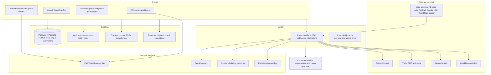

# Lawnquoter Platform Design Spec

Date: 2026-10-08
Status: approved by owner (plan-mode approval)
Research inputs: docs/research/2026-10-08-competitor-feature-inventory.md, docs/research/2026-10-08-voice-of-customer.md, docs/research/2026-10-08-technical-feasibility.md

Scope decisions: full field-service suite planned as one product with an ordered build sequence; single-tenant for the owner company first, multi-tenant-ready from day one; Next.js + Supabase (Postgres/PostGIS) + shadcn/ui + Vercel; all seven service lines (mowing, fert/weed programs, one-time jobs, installs/design-build, snow, irrigation, commercial multi-site bids); no legacy data migration.

# Lawnquoter Platform Blueprint

## 1. What the research found

Three background research passes (competitor features, user feedback, technical feasibility; ~100 sources) produced these conclusions that drive the design:

**White space nobody fills today**
- No product spans instant residential self-quoting (Deep Lawn / Lawnbot class) AND production-rate commercial cost-up estimating with change orders and renewals (LMN / Aspire class). Owners describe the market as "too simple (Jobber) or too complex and expensive (Aspire)."
- Speed-to-lead is marketed by everyone and measured by no one. Lead scoring does not exist natively anywhere.
- Instant quotes convert worse when they are binding prices from unverified measurements; owners who tried them report 50-70% of normal close rate and price-shopper leads. The unmet need is a price *range*, qualification gates, stated minimums, and a "pending site verification" quote state.
- Measurement tools fail on canopy, slope, gates, outdated imagery, new construction, wrong parcel, and charge for unusable lookups. Nobody captures the real pricing modifiers operators use (gate width, slope %, first-cut multiplier, bagging, travel time, minimums).

**Most valued features (ranked by owners)**
1. Quoting without driving to the property (minutes, not next-day)
2. Satellite measurement that is editable before sending
3. Optional / good-better-best line items with photos (a cited $9.4K job became $14K)
4. Quote -> job -> invoice with zero re-entry, on-site e-sign, card on file
5. Automated follow-up and text-to-quote
6. Templates and production rates for estimator consistency (commercial)

**Top pain points to design around**
- Per-user seats, add-on creep, forced payment processors, 12-month lock-in, $500 data exports. Flat pricing, month-to-month, and clean export are explicit 2026 purchase criteria.
- QuickBooks sync is one-directional or broken in nearly every product; commercial users lose per-property revenue because sub-customers do not sync.
- Rigid quotes after approval: no change orders, cannot split a quote into multiple jobs or invoice partial scope.
- Residential tools cannot do parent/child accounts, NET terms, PO numbers, consolidated or progress billing; the "client" is assumed to be the payer.
- Mobile field apps lose data on screen-off and have no offline mode.
- Funnel reporting (leads -> quotes -> close rate by source) is fragmented.

**Hard technical constraints discovered**
- Google Maps imagery cannot legally be the measurement canvas (ToS bans tracing and ML extraction; the Drawing Library was removed May 2026). Mapbox satellite is non-commercial-only for tracing. Use Esri World Imagery (tracing explicitly permitted) for the canvas, and Esri stored geocoding (`forStorage=true`) for addresses that are persisted.
- Supabase Edge Functions have a 2s CPU cap: PDF rendering and any ML go in Vercel functions or a container service.
- SMS requires per-tenant A2P 10DLC brand registration (2-4 weeks lead time); plan the onboarding flow.
- Service Autopilot and LMN have no public APIs; Jobber, QuickBooks Online, and Housecall Pro (MAX) do.

## 2. Product principles (derived from the research)

- Quote from the desk in under five minutes; drive only to confirm high-value or low-confidence jobs.
- Every automated measurement carries a confidence score; low confidence yields a range and a "site verification pending" quote state rather than a binding price.
- Pricing returns price, budgeted hours, and cost on every line (SA Rate Matrix model), so job costing and $/man-hour feedback are automatic.
- One quote engine serves both segments: tier tables for residential recurring, kits/assemblies with production rates and overhead recovery for commercial and design-build.
- Quotes are versioned, never frozen: change orders have lineage, and a quote can split into multiple jobs and partial invoices.
- Accounts are hierarchical from day one: Account -> Sites/Properties -> Contacts, with payer separate from site contact.
- Flat per-company pricing, no per-seat fees, month-to-month, one-click full data export (CSV + JSON).
- Mobile is an offline-first PWA with local persistence; nothing is lost when the screen locks.

## 3. Architecture

**Stack**: Next.js (App Router, TypeScript), Supabase (Postgres 15+ with PostGIS, Auth, Storage, Realtime, pg_cron), shadcn/ui + Tailwind, MapLibre GL JS + Terra Draw + Turf.js, `@react-pdf/renderer`, Stripe Connect (Express), Twilio, Resend (React Email), Vercel. Testing: Vitest (unit, pricing engine), Playwright (e2e), pgTAP (RLS deny tests). Monorepo with `apps/web`, `apps/widget`, `packages/pricing-engine`, `packages/db` (types + migrations), `packages/ui`.

**Tenancy**: every table carries `org_id`; RLS enabled and FORCED; `org_id` and role stamped into `app_metadata` via the custom access token hook and read in policies as `(select auth.jwt()) -> 'app_metadata' ->> 'org_id'`; a `memberships` table is the source of truth for role changes. Public quote pages and the widget use signed-token RPCs, never the anon role against tenant tables. Single org at launch; onboarding, SaaS billing, and org switching are a late module, but nothing has to be rewritten to enable them.

**Geometry**: `geography(Polygon, 4326)` columns, GiST indexed, exposed via RPCs returning GeoJSON. Client computes area/perimeter with Turf for instant feedback; PostGIS `ST_Area` is the source of truth stored on the measurement.

## 4. Core data model

- `orgs`, `memberships`, `users` (roles: owner, admin, sales, dispatcher, crew_lead, crew, read_only)
- `accounts` (residential or commercial, parent/child for property managers and HOAs, billing terms NET0/15/30/60, PO required flag, tax exempt), `contacts` (roles: site contact, billing contact, decision maker), `properties` (address, geocode, parcel geometry, footprint geometry, gate width, slope class, access notes, imagery date)
- `measurements` -> `measurement_features` (category: turf_front, turf_back, bed, hardscape, driveway, sidewalk, edging_line, fence_line, canopy, roof; geometry; area/length; source: auto, traced, manual, imported; confidence)
- `services` (catalog), `pricing_rules` (tier matrix, cost-up assembly, catalog markup), `modifiers` (slope, gate, bagging, first-cut, travel zone, minimum, seasonal), `production_rates`, `materials`, `equipment`, `labor_rates`, `overhead_recovery`
- `leads` (source, UTM, first_response_at, qualification answers, score), `pipeline_stages`, `opportunities`, `tasks`, `activities` (every email/SMS/call/visit, timestamped)
- `quotes` -> `quote_versions` -> `quote_sections` -> `quote_line_items` (state: included, recommended, optional; price, hours, cost; photos), `quote_options` (good/better/best groups), `acceptances` (hash of version, signer, IP, UA, ESIGN disclosure accepted, hash-chained audit events), `change_orders` (parent quote version, deltas)
- `agreements` (recurring mowing, fert program with application schedule, snow per-push/seasonal/per-inch, irrigation service plan, commercial annual contract with renewal date), `jobs`, `visits`, `routes`, `time_entries`, `job_costs`, `chemical_applications`, `snow_events`
- `invoices`, `invoice_lines`, `payments`, `payment_methods` (Stripe), `qbo_sync_log`
- `automations`, `message_templates`, `messages` (email/SMS in and out), `integrations`, `webhooks_in`, `export_jobs`

## 5. Modules and features

Each module lists the best-in-class features to replicate (with the product that sets the bar) plus the white-space features from the research.

### 5.1 Accounts, contacts, properties
- Hierarchical accounts with sites (SingleOps/Aspire); payer separate from site contact; NET terms, PO numbers, tax exemption
- Property record with geocode, parcel boundary (Regrid), building footprint (Overture), imagery date, access attributes (gate width, slope, stairs, dogs, obstacles) that feed pricing modifiers
- Timeline of every interaction; duplicate detection by address and phone

### 5.2 Measurement studio
- Esri imagery canvas with Terra Draw polygon/line/freehand tools, snapping, cut/subtract, categories, live sq ft / linear ft (RealGreen Measurement Assistant, SA Smart Maps bar)
- Auto-prefill "parcel minus footprint minus driveway" as a starting turf polygon; front/back split by footprint line (Deep Lawn)
- Confidence score from imagery age, canopy overlap, parcel match, and footprint presence; manual size entry fallback always available (Rachio yardmapper pattern)
- Multi-date imagery toggle where available; later: Nearmap/Vexcel HD layer and NAIP-trained segmentation for one-click prefill; Beam AI import for commercial takeoffs
- Measurement reused across every future quote for that property; bulk measure for commercial portfolios

### 5.3 Service catalog and pricing engine (`packages/pricing-engine`, pure TypeScript, fully unit-tested)
- Rule type A: tier matrix on any measured quantity returning price, hours, and cost, with an "every N over X adds Y" tail row (SA Rate Matrix)
- Rule type B: assemblies/kits of labor + equipment + materials driven by production rates, with overhead recovery and target margin (LMN/Aspire); complexity slider per property (Go iLawn)
- Rule type C: catalog items with material/labor markups (Jobber)
- Modifiers: slope %, gate width, bagging, first-cut multiplier, obstacle count, travel-time/drive-distance zones, route-density discounts (Deep Lawn Geopricing), per-service minimums, seasonal factors
- Program builder for multi-application fert/weed plans with per-app or prepay pricing and discounts by app count
- Snow contract types: per-push, per-inch tiers, seasonal flat, with trigger depth; irrigation zone-count pricing that also sets visit duration (HindSite)
- Output is always a priced range when input confidence is low, a point price when high
- Mass price updates, price-list versioning, SiteOne/Home Depot material price import (CSV first, API later)

### 5.4 Quote and proposal builder
- Templates per service line; sections and work areas; three-state items included/recommended/optional (SingleOps); side-by-side good/better/best with per-option totals (Housecall Pro)
- Photos per line item, header/footer imagery, reviews block, attachments, client-facing vs crew-facing notes (LMN/SingleOps)
- Mobile-first web proposal page with live total as the customer toggles options, plus branded PDF via react-pdf; property map image embedded
- Versioning with diff; change orders with add/delete/substitute lineage and accepted/declined amounts (Aspire); split an accepted quote into multiple jobs
- AI-assisted draft quote from an inbound request using templates and past quotes for similar-size properties nearby (Jobber), with neighborhood price memory

### 5.5 Delivery, acceptance, payment
- Send by email and SMS with tracked open/view events; expiry dates
- Click-to-accept with ESIGN-compliant audit trail (document hash, identity via magic link, timestamp, IP/UA, disclosure acceptance, hash-chained events, sealed PDF); optional SignWell for formal commercial contracts
- Stripe Connect: deposits, card on file, ACH with instant verification, pay remainder after service; consumer financing link (Wisetack) later
- Follow-up sequences (email/SMS) that stop on reply, view, or acceptance, and create a call task for the rep (Arborgold); "quote gone quiet" flags (Jobber Pipeline)

### 5.6 Lead capture and pipeline
- Hosted and embeddable request forms; generic inbound webhook and Zapier app; Facebook Lead Ads webhook; CallRail/Twilio call tracking with recording links; two-way SMS inbox
- Instant-quote widget: address -> service-area geofence check -> qualification questions -> measurement -> price range with stated minimum -> capture contact before showing the number (MeasureLawn) -> optional deposit to lock -> "we confirm within 24h" state. Customer may trace their own lawn (Lawnbot/QuoteIQ). UTM capture, abandoned-quote automation
- Later connectors: Google LSA leads (Google Ads API), Thumbtack partner API, Yelp, Angi webhook
- Pipeline kanban with auto-advancing stages, owner, tasks, lost reasons, rotting flags
- Speed-to-lead instrumentation: time from lead creation to first human response and to first quote sent, per rep and per source
- Lead scoring: property size vs minimum, service fit, distance from route density, source history, engagement; surfaces "quote now" vs "qualify first"

### 5.7 Agreements, programs, renewals
- Convert accepted quote to recurring agreement (weekly/biweekly/seasonal), fert program schedule, snow contract, irrigation plan, or commercial annual contract
- Renewal pipeline with price-increase rules and one-click renewal proposals (Aspire renewals report)
- Enhancement/upsell proposals attached to an existing agreement; level billing

### 5.8 Scheduling, routing, dispatch
- Calendar and dispatch board (day/week/crew), drag-and-drop, recurring visit generation from agreements, weather skip/reschedule rules, snow event activation
- Route optimization per crew per day with drive-time estimates (fixed route days supported, the thing Jobber users hack around)
- Realtime crew status

### 5.9 Crew mobile PWA
- Offline-first (IndexedDB queue, background sync), installable, large tap targets
- Today's route, property map with measured features and crew notes, start/stop timers, before/after photos, checklists, chemical application logging (product, rate, EPA reg no., weather), snow event logging (trigger, start/end, materials), irrigation zone notes
- Enhancement capture on site: photo + note creates an upsell quote draft for the office (Aspire tag-on sales)

### 5.10 Job costing, invoicing, payments, accounting
- Estimated vs actual hours and cost per job and per agreement; $/man-hour and gross margin per service, per crew, per customer (CLIP, LMN)
- Invoicing: per visit, monthly, level billing, progress billing on partial scope, consolidated invoices per parent account with per-site detail, PO numbers, NET terms, late fees, auto-charge card on file
- QuickBooks Online two-way sync with sub-customer mapping for sites, refund and edit propagation, sync log and conflict UI

### 5.11 Commercial bidding
- Portfolio accounts with many sites; bulk measurement; bid package builder responding to spec line items with unit prices and frequencies
- Site walk mode in the PWA: geotagged photos, voice-to-text notes pinned to the map (SiteRecon/Attentive OnSite)
- Bid pipeline statuses (pre-bid, bidding, submitted, awarded, lost) and bid calendar
- Beam AI / SiteRecon takeoff import (GeoJSON/XLS) for large sites

### 5.12 Customer portal
- View and approve quotes, sign, pay, see schedule and visit photos, request service, update card; works for parent accounts across sites

### 5.13 Analytics
- Funnel: leads -> quoted -> accepted by source, rep, service line, with speed-to-lead and days-to-close
- Pipeline value and forecast; win/loss reasons
- Estimated vs actual, $/man-hour, margin by service and crew; route density map
- Widget funnel: address entered -> qualified -> contact captured -> quote viewed -> deposit

### 5.14 Settings, admin, SaaS readiness
- Branding, users and roles, service catalog, pricing, templates, automations, integrations, sending domain (DKIM/SPF), SMS 10DLC onboarding flow
- Full data export (CSV + JSON + PDFs) on demand
- Later: org onboarding wizard, Stripe Billing subscription (flat per-company tiers), org switcher, usage metering for imagery sessions and measurements

## 6. Build sequence

Planned as one product; this is the order the modules land so each is usable as it ships. Each step gets its own spec and task-level implementation plan (writing-plans skill) before coding.

1. Foundation: monorepo, Supabase project, migrations, orgs/memberships/RLS with pgTAP deny tests, auth hook, design system, CI, seed data
2. Accounts, contacts, properties with geocoding, parcel, and footprint lookup
3. Measurement studio
4. Pricing engine package and service catalog UI
5. Quote builder, web proposal, PDF
6. Acceptance, e-sign audit trail, Stripe Connect deposits and card on file
7. Lead intake (forms, webhook, SMS inbox, call tracking), pipeline, follow-up automations, speed-to-lead
8. Instant-quote widget
9. Agreements, programs, snow and irrigation contract types, renewals, change orders
10. Scheduling, routing, dispatch
11. Crew PWA (offline), time tracking, chemical and snow logs, on-site enhancements
12. Invoicing, payments, job costing, QuickBooks sync
13. Commercial bidding: portfolios, bulk measure, bid packages, site walks, takeoff import
14. Customer portal and analytics
15. External lead connectors (Google LSA, Thumbtack, Yelp, Angi, Zapier app) and HD imagery / segmentation
16. SaaS: onboarding, subscription billing, org switching, metering

## 7. Key decisions

- Esri World Imagery, not Google or Mapbox, as the measurement canvas (licensing). Get written confirmation from Esri for the measure-and-store use case before scaling.
- Instant quotes show ranges and require a confirmation step by default; binding instant prices are an opt-in per service when measurement confidence is high.
- Self-built click-to-accept (ESIGN-compliant audit trail) as default; SignWell only for formal contracts.
- `@react-pdf/renderer` in Vercel route handlers; no headless Chromium.
- Pricing engine is a pure, dependency-free TypeScript package shared by the office app, the widget, and server-side recalculation.
- Flat per-company pricing with no per-seat fees when it becomes SaaS; data export is a first-class feature, not an afterthought.
- No legacy data migration at launch; CSV import exists for customers and properties only.

## 8. Verification strategy

- Pricing engine: Vitest golden tests per rule type and modifier, property-based tests for monotonicity (bigger lawn never cheaper)
- RLS: pgTAP tests asserting cross-org reads/writes are denied for every table
- Geometry: PostGIS area within 1% of Turf area on fixture polygons; parcel/footprint lookups mocked
- E2E (Playwright): lead -> measure -> quote -> accept -> deposit -> agreement -> scheduled visit -> invoice -> QBO sync (sandbox)
- PWA: offline capture then sync tests with network throttling

## 9. First actions on approval

- Write the research reports into `docs/research/` (competitors, voice-of-customer, technical feasibility) so they survive this session
- Write the product spec to `docs/superpowers/specs/2026-10-08-lawnquoter-platform-design.md` from this plan
- Produce the task-level implementation plan for Step 1 (Foundation) and Step 2 and begin execution